# SIPHOKUHLE MILLIOR ANGELA NYANA

📞083 243 2798 | 🌐 [Portfolio](https://siphokuhlemilliornyana.netlify.app/) | [LinkedIn](https://www.linkedin.com/in/siphokuhlenyana-6a917016a/)

* * *

## Profile

Adaptable developer who thrives in both team and independent environments, with a keen eye for problem-solving. Passionate about growth, with hands-on experience in full-stack web development and a drive to continuously upskill.
<video width="100%" height="350px" controls>
  <source src="https://github.com/user-attachments/assets/df853a22-2b3c-4844-ac3f-9d6304c80d91" type="video/mp4">
</video>

* * *

## Technical Skills

`HTML` `CSS` `JavaScript` `Java` `Python` `React JS` `Node JS` `Vue JS` `Agile SCRUM` `MYSQL` `Git`

* * *

## Work Experience

### Software Engineer Intern — LC Studio, Lansdowne

*October 2024 – January 2025*

- **Situation:** LC Studio needed a team to work on a software development using the SCRUM Agile Methodology , given a week deadline.
- **Task:** I was responsible for managing the team (using work breakdown structure ) , working at the backend of the software and fixing bugs I encountered.
- **Action:** Used these technologies :`Trello` , `Python` , `Flask`
- **Result:** Delivered a scalable software that was fully functional , improved load time, launched on time.

### IT Support / Teacher’s Assistant — Weltevreden V.C.P.S, Samora Machel

*February 2023 – November 2023*

- **Situation:** The school needed assistants to assist in class with managing the classroom , coordinate with tasks planned from week to week .I would also step in as an `eCadre` support when students have computer lab sessions.
- **Task:** Tasked with managing the classroom , offer emotional support to learners , doing scripts analysis and governmental paperwork for quality assuarance .
- **Action:** Applied these skills into action : `Word` , `Excel` , `Communication etiquette` in practise .
- **Result:** Achieved to mantain an open communication in a place of work , increased time to improve my skills and apply them more into practise .These tasks also taught me how to regulate my emotions as I was dealing with learners from different backgrounds and upbringing .

* * *

## Projects

### CampusMate — CPUT Clinic Booking System

- **Situation:** CPUT students had no easy way to book clinic appointments, leading to long queues and missed visits.
- **Task:** Designed and built a web-based booking system as part of a student project.
- **Action:** Developed the frontend using `React JS` and backend with `Node JS`, implementing booking logic, user authentication, `MySQL` for the databases and appointment scheduling.
- **Result:** Delivered a fully functional system that streamlined the booking process for students and clinic staff.

### Student Enrolment System

- **Situation:** Manual student enrolment was time-consuming and error-prone.
- **Task:** Built a digital system to automate and simplify the enrolment process.
- **Action:** Used `Java` & `Derby Databases` to create a form-based system with data validation and record management.
- **Result:** Reduced enrolment processing time and improved data accuracy.

* * *

## Education

**CPUT** - Diploma in ICT : Applications Development (*Current*)

**Life Choices Academy** — Full Stack Web Development Bootcamp (*April 2024 – September 2024*)

**CPUT** — Higher Certificate in ICT (*2018*)

* * *

## References

**Darron Gelderbloem** | darron@lifechoices.co.za | 021 696 4157

| **Pearl Sisipho Ngcuka** | pearlngcuka@gmail.com | 072 356 6897 |
|--------------------------|-----------------------|--------------|

* * *

## Reflection on the Mockup video

- **Situation:** During my mockup video , I was asked follow-up questions after presenting my main points. The challenge was that I struggled to respond immediately and structure my answers without making the video overly long.
- **Task:** My task was to demonstrate clear, professional communication by answering questions effectively, showing that I could think on my feet while keeping my responses concise and relevant.
- **Action:** To manage this I tried to apply the STAR method in real time:
  - Identified the Situation quickly to set context without overexplaining.
  - Clarified the Task in one sentence to show understanding.
  - I shared the action I took, focusing on 1–2 key steps rather than a full breakdown.
  - Concluded with the result, highlighting the impact in a short statement.
  - I also reminded myself to pause briefly before answering, which helped me organize my thoughts and avoid rambling.
- **Result:** Although I initially struggled, I was able to keep my answers structured and avoid making the video too long. The feedback I received noted that my responses became clearer once I leaned on the STAR framework. I learned that even under pressure, pausing to mentally map out STAR helps me stay concise and professional. Going forward, I plan to practice short, structured answers so I can navigate questions more smoothly in real-time.

* * *

## Reflection on using Github Pages

- **Situation:** I used GitHub Pages to host and share my mockup video. The goal was to make the video easily accessible online through a simple webpage.
- **Task:** My task was to successfully upload the video and ensure it displayed correctly on GitHub Pages, demonstrating both technical ability and clear communication of my work.
- **Action:** While setting up the page, I encountered a problem: the video would not upload or display properly. To address this, I:
  - Checked the file format and size to ensure compatibility.
  - Reviewed the repository structure to confirm the video was placed in the correct folder.
  - Adjusted the HTML code to reference the video file correctly.
  - Tested the page multiple times, making small changes until the video finally appeared as intended.
- **Results:** Although this process was frustrating at first, I eventually resolved the issue and got the video to display on GitHub Pages. This taught me the importance of troubleshooting, patience, and attention to detail when working with web hosting tools. I also realized that documenting each step helps me avoid repeating mistakes in the future. Overall, the experience strengthened both my technical skills and my ability to communicate effectively through digital platforms.

* * *

## Agile Portfolio: Item Hive

Item Hive is a six-person e-commerce web application with customisable products, a cart and checkout, payment integration, an admin dashboard and order tracking. We managed it with Scrum on Trello in four-day sprints.

🔗 [Trello board: Item Hive](https://trello.com/b/jMjTyQX1)

**Contents:** [Agile Team Charter](#agile-team-charter) | [User Stories and Tasks](#user-stories-and-tasks) | [Product Backlog](#product-backlog) | [Sprint Backlog](#sprint-backlog) | [Agile Logbook](#agile-logbook)

* * *

## Agile Team Charter

### Evidence

Our charter was built as a Work Breakdown Structure (WBS) card on the **Project Charter** list in Trello. Its checklist covers:

- Team Purpose
- Team Roles & Responsibilities
- Team Values & Principles
- Communication Plan
- Goals & Milestones
- Compilation (the final combined document)

When the team shrank, we opened a second card, **NEW PC**, to restructure the project. It has a Change Log and a Roles checklist that moved from *Pending* to *Updated*. We also agreed a **Brand Guide** (mission, vision, values, logo, colours, typography) that every member signed off.

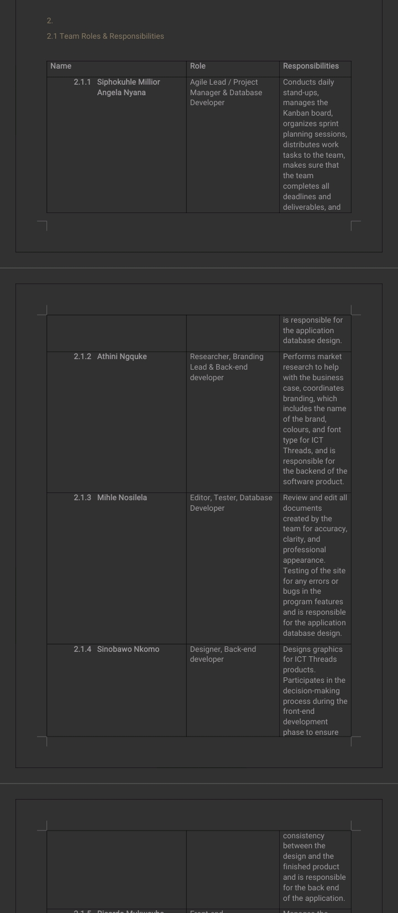
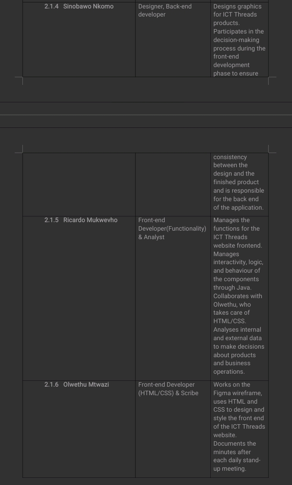
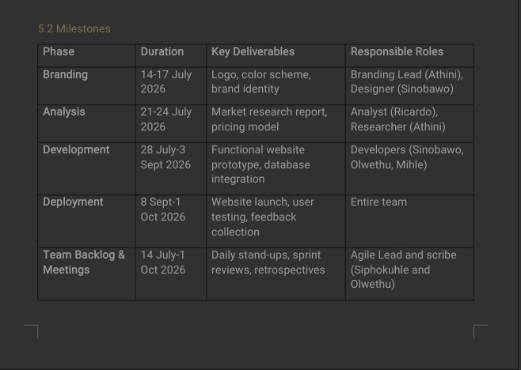

### Reflection

- **Situation:** At the start of the project six of us had to work as one team on a shared product. Later a member left, and the work had to be redistributed.
- **Task:** My task was to help make the charter a working agreement we could use every day, not just a document to hand in. After the member left, we had to update it.
- **Action:** We agreed our purpose, roles, values and communication plan together, then recorded them in the WBS card. Communication ran through a WhatsApp group where meetings were held and roles assigned. When the team changed, we opened the NEW PC card, logged the change, and updated roles so every remaining member had clear ownership. 
- **Result:** The charter gave us a reference point when the team changed, and the sprint cards show that everyone kept clear, named responsibilities afterwards. I learned that a charter has to be a living document. The first version was only useful because we were willing to revise it. 

* * *

## User Stories and Tasks

### Evidence

Every sprint card in Trello holds a **user story** in its description and a **checklist of subtasks**, each assigned to one member. Examples from our board:

| Sprint card | User story | My subtask |
|---|---|---|
| Sprint 2, Day 2: Cart entity | *As a customer, I want the product items to have accurate stock levels so that I do not order items that are out of stock.* | Create cart endpoints |
| Sprint 3, Day 1: Authentication | *As a user I want to have secured authentication and reset my password option, so that I can regain access when I have forgotten my login credentials.* | Integrate authentication with carts |
| Sprint 4, Day 3: Payment integration | *As a customer, I want to pay for my items seamlessly so that my order can be successfully created.* | Sandbox testing |
| Sprint 5, Day 1: Admin setup | *As an admin, I want to authenticate and access a secure dashboard so that I can manage system operations.* | Access control |

Each day-card follows the same pattern: a story, then five or six tasks covering build, test, integrate, review and deploy.

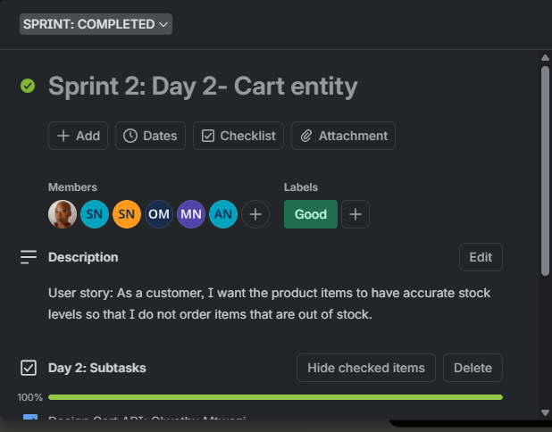
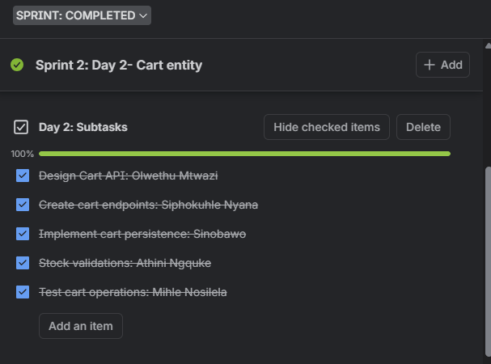

### Reflection

- **Situation:** A feature such as "checkout" was too big to assign to one person or finish in one day. We needed a way to break it down so everyone knew what to do and how it served the user.
- **Task:** Write user stories from the user's perspective and break each one into small tasks that could be assigned, tracked and tested within a four-day sprint.
- **Action:** We wrote stories in the form *As a user, I want a checkout feature to weigh my options , so that it will be convinient for me  and we split each into subtasks with the team. My tasks leaned towards testing, integration and deployment, for example unit tests for the product API, integrating authentication with the cart, and deploying the sprint. 
- **Result:** Writing the "so that" part forced us to think about why a feature mattered, and the named subtasks made progress visible on the board. I learned that a story is only good when it can be tested. 

* * *

## Product Backlog

### Evidence

We kept two versions of the **PRODUCT BACKLOG** list on the board.

**Original backlog (archived, Sprints 1 to 15):** the full plan was ordered in phases:

- Sprints 1 to 3: documentation, target market, problem statement, team structure and charter
- Sprint 4: compilation, brand guide, front-end wireframes
- Sprint 5: front-end pages (login, profile, product, checkout) and the Cart entity
- Sprints 6 to 9: entities, then back-end domain/factory/service/repository/controller for each entity
- Sprints 10 to 12: back-end and front-end testing, integration, final system testing
- Sprints 13 to 15: pre-deployment, deployment, post-deployment and handover

**Revised backlog (current, Sprints 10 to 16):** after the project restructured, we rewrote the remaining work as day-by-day items, each with a user story: analytics and dashboard UI, reporting, expansion of the catalogue, end-to-end, regression and acceptance testing, documentation, launch preparation, monitoring, go-live, post-launch review and final handover.

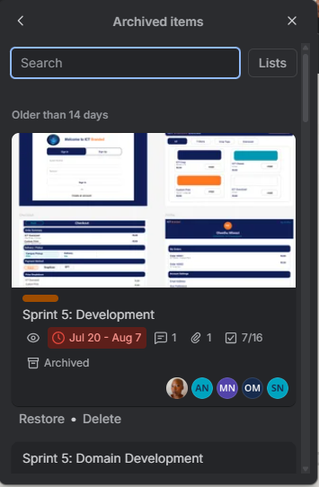
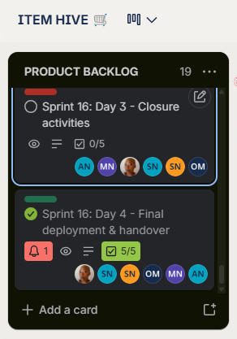

### Reflection

- **Situation:** Our first backlog was planned phase by phase, and it assumed the whole team would be available for the whole project. When the team changed and the work moved faster than planned, it no longer matched reality.
- **Task:** Re-prioritise the backlog so the remaining sprints were realistic and still delivered a working product.
- **Action:** We archived the original list and wrote a revised backlog in which each item has a user story and five named subtasks. Items were ordered by what the next sprint depended on, for example testing before deployment, and documentation before launch. As a team we decided to rank out rather put our tasks in priority partitions being that the ones that require much attention can be solved a group if the person allocated to the issue needs help .
- **Result:** The revised backlog is more specific and easier to act on than the original. The statuses on the board show what is finished and what is still open. I learned that a backlog is a prioritised, changing list, not a fixed plan, and that re-planning early is cheaper than late. 

* * *

## Sprint Backlog

### Evidence

Each sprint ran for four days and used the same rhythm: Day 1 to 3 build features, Day 4 review and deploy. Sprints 1 to 8 are on the **SPRINT: COMPLETED** list and Sprint 9 is on **SPRINT: IN PROGRESS**.

| Sprint | Sprint goal (from the Trello cards) |
|---|---|
| 1 | Setup, core product catalogue, product listing, initial customisation |
| 2 | Cart page, cart entity, checkout start, order creation |
| 3 | Authentication, profile dashboard, order history and wishlist |
| 4 | Advanced customisation, customisation backend, payment integration |
| 5 | Admin setup, product management, order management |
| 6 | Order workflow, admin fulfilment, student tracking |
| 7 | Home page, feedback tools, sharing and notifications |
| 8 | Core testing, UI improvements, performance, deployment pipeline |
| 9 (in progress) | Security hardening, data protection, reliability, deploy |

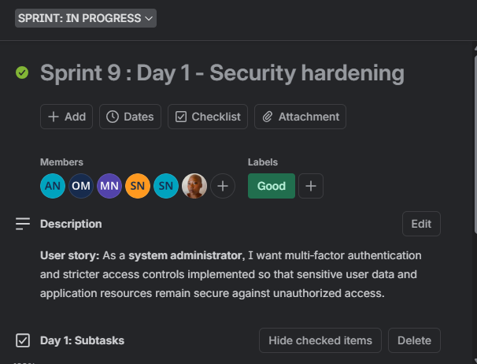
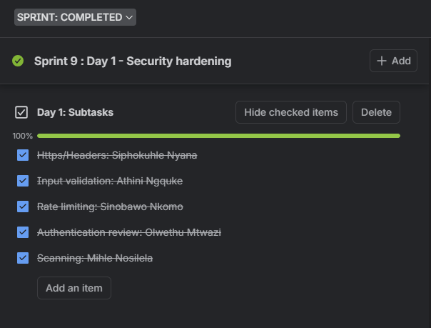

### Reflection

- **Situation:** With five or six people working in four-day sprints, every day had to have clear work for each person, or the whole team would stall.
- **Task:** Turn items from the product backlog into a sprint plan that the whole team could finish and deploy by Day 4.
- **Action:** We pulled work from the product backlog into day-cards, assigned each subtask to a member, and ticked checklist items as they were completed. Day 4 was always reserved for review, documentation and deployment.To make sure this is done seamlessly we had a catchup sessions in between sprints varying from the difficulty of the sprint , I was responsible for making sure we were on the same page so that we get good results at the end of each prints . Collaborately this wasn't a "one man" jive thing we as the team took turns to do project management.
- **Result:** Sprints 1 to 8 are mostly complete on the board, and each ended with a deployment. A few items, such as Sprint 4 Day 4 and Sprint 7 Days 1 and 3, still have open checklist items, which shows that we sometimes planned more than we could finish.A blocker at this point was incoming requests from the coordinator for certain changes and advise and  I learned to commit to what the team can realistically deliver.

* * *

## Agile Logbook

### Evidence

The logbook records what the team planned each sprint, what I worked on, and what we learned. The first two columns come from our Trello board.You can also have a look on the attached documents in this repository for more context.

| Sprint | Sprint goal | My tasks | What went well / blockers / what I would change |
|---|---|---|---|
| 1 | Setup, catalogue, listing, customisation | GitHub setup and project structure; unit tests for product API; consume endpoints on the front end; deploy initial version to staging | [Everything went well |
| 2 | Cart, checkout, orders | Display running totals; create cart endpoints; test cart-to-checkout flow; deploy Sprint 2 | Follow up after analysis |
| 3 | Authentication, profile, wishlist | Integrate authentication with carts; connect profile to authentication; integration testing; performance checks | Email Auth went well |
| 4 | Customisation, payments | Enhance live preview; backend testing; payment sandbox testing | No blocker |
| 5 | Admin dashboard and management | Access control; bulk actions; testing; deployment | No blocker |
| 6 | Order workflow, fulfilment, tracking | Enhance status logic; testing; polishing; deployment | This works seamless |
| 7 | Home page, feedback, notifications | CTAs; survey integration; testing; debugging |Everything went well after debugging |
| 8 | Testing, UI, performance | Journey tests; navigation; retesting; regression testing |Render services at some point were a blocker but we managed to make it work|
| 9 | Security, data protection, reliability | HTTPS and headers; testing; documentation; deployment | Render & Vercel gave us issues ] |

**Stand-up format we used:** What did I do yesterday? What will I do today? Is anything blocking me?

**Retrospective format (Day 4):** What went well? What did not? What will we change next sprint?

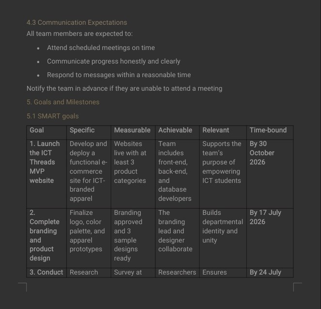
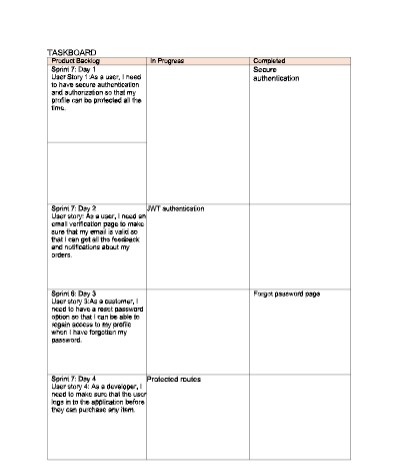
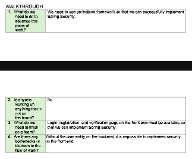

### Reflection

- **Situation:** In a team working at pace, it is easy to lose track of what was decided and why.
- **Task:** Keep a record of planning, daily progress and retrospectives so the team and I could look back and improve.
- **Action:** I recorded the sprint goal, my tasks and my observations for each sprint, using the board for planning and the team chat for meetings. I set a poll on our whatsapp group chat and one would check the subtasks they want to work on by this it gave us enough time to spot out the subtasks that still need to be done and are not allocated to anyone
- **Result:** Looking back across nine sprints, I can see my role settle into testing, integration and deployment, and I can see the problems repeat when we did not act on a retrospective.  I learned that a logbook is only useful when its notes feed into the next sprint plan.

* * *

## Connecting the Evidence

Our team charter set the roles, values and communication plan that shaped every sprint, and when a member left, the **NEW PC** card showed how a living charter let us restructure instead of stalling. The user stories we wrote from the customer's and admin's perspective became the items that filled the product backlog, and each one was broken into assigned subtasks so everyone knew what they owned. When the team changed, we re-prioritised that backlog and rewrote the remaining sprints as day-by-day items, which is where the sprint backlog turned planning into four-day cycles of building, testing and deploying. The agile logbook then captured what each sprint taught us, showing where our plans held and where open items on the board revealed that we had committed to more than we could deliver.

### How the Trello Board Ties It Together

The Item Hive Trello board is the single place where all five pieces of evidence connect. Its lists follow the life of the project: the **Project Charter** list holds the team's agreements, the **Product Backlog** lists hold the planned work (first as the original 15-sprint plan, then as the revised Sprint 10 to 16 plan), and the **Sprint: Completed** and **Sprint: In Progress** lists show that work being done. Within these lists, each card carries a user story, a checklist of subtasks and named owners, so a single card links the charter's roles, the backlog's priorities and the sprint's daily work. The archived and revised backlogs side by side also show how our thinking changed over time.

The board also made our progress visible and accountable. Ticked checklist items, labels and the Day 1 to Day 4 rhythm let any member see what was finished, what was open and who owned it, while the Meetings card and brand guide gathered our shared decisions in one place. Its limits taught me as much as its strengths: Trello recorded *what* we planned and completed, but it held very little of *why* we made decisions or what we learned, and a few labels did not match the state of the checklists. This showed me that a board is a strong planning and tracking tool, but it needs a logbook and regular retrospectives beside it to capture reflection.

### What I Would Do in the Next Project

- **Keep the logbook alongside the board.** Write short stand-up and retrospective notes in Trello card comments or a shared document at the end of each sprint day, so the reasons behind decisions are recorded as they happen.
- **Keep labels and checklists accurate.** Review the board at the end of every sprint so that labels such as "Done" and "Not Done" match the checklists, and move unfinished items into the next sprint on purpose instead of leaving them open.
- **Plan for team changes in the charter.** Add a rule for what happens when a member leaves or joins, including how roles are reassigned and how the backlog is re-prioritised.
- **Commit to less per sprint.** Use the open items from this project as evidence of our real capacity, and plan the next sprint around what we actually finished.
- **Use retrospectives to change the plan.** Turn each retrospective into one concrete change for the next sprint, and check at the next retrospective whether it worked.

**What I will take into my next project:** I will write retrospective notes at the end of every sprint and use them to adjust the following sprint plan, rather than only recording them.

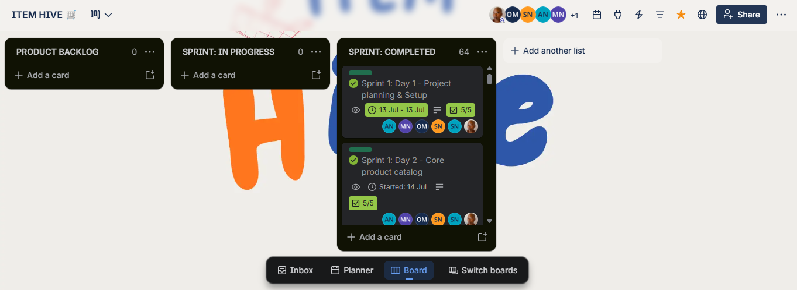
